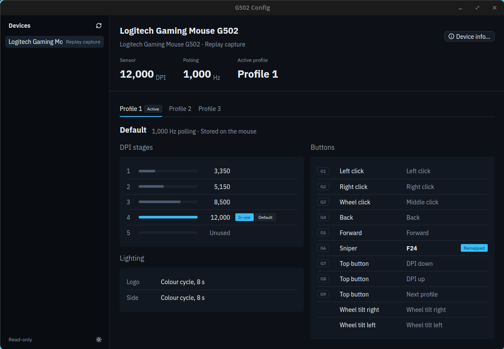

# hidra

Linux tooling for Logitech mice (starting with the G502 family) that speaks
HID++ 2.0 directly over hidraw: a
desktop viewer, a command-line inspector, and a device-report collector.



**Status: read-only.** Nothing in this repository can change a device's
settings yet. Editing comes next, behind a full backup and byte-for-byte
read-back verification. Protocol notes are in [RESEARCH.md](RESEARCH.md).

## Tested devices

| Device | USB ID | Connection | Reads verified |
| --- | --- | --- | --- |
| G502 Proteus Spectrum | `046d:c332` | USB cable | Firmware `U1 03.02.B0012`: info, three onboard profiles, factory profiles, full backup |
| G502 LIGHTSPEED | `046d:407f` | LIGHTSPEED receiver `046d:c539` | Firmware `MPM 17.00.B0008`: info, battery, factory profile, full backup |

`g502ctl info` and `g502ctl report` work on any Logitech device that speaks
HID++ 2.0. Onboard-profile decoding covers profile formats 1–5 and has only
been checked on the two mice above.

**Have a different Logitech mouse or keyboard?** Send a device report so it can
be supported: [docs/device-reports.md](docs/device-reports.md). Collecting one
only reads from the device.

## Install

Needs Rust and Linux.

```sh
cargo build --release

# Let your user read the mice without root:
sudo install -m644 packaging/70-g502ctl.rules /etc/udev/rules.d/
sudo udevadm control --reload && sudo udevadm trigger --subsystem-match=hidraw
```

The udev rule covers the two tested mice. For other devices, run `g502ctl`
with `sudo`, or add the product ID to the rule.

## Desktop viewer

```sh
cargo run --release -p g502-config            # dark theme
cargo run --release -p g502-config -- --light
```

Shows each mouse's sensor DPI, polling rate, battery and active profile, and
for every onboard profile its DPI stages, button assignments (remapped buttons
are marked) and lighting. Firmware and storage details are under
**Device info…**.

Keys: `Ctrl+R` refresh, `Alt+Up/Down` switch device, `Ctrl+Tab` switch
profile, `Ctrl+I` device info, `Ctrl+Shift+L` light/dark, `Ctrl+Q` quit.

## Command line

```sh
g502ctl list                    # Logitech HID++ nodes
g502ctl info                    # features, firmware, DPI, polling rate, battery
g502ctl profiles                # decoded onboard profiles
g502ctl backup --out backups    # every onboard-memory sector, raw
g502ctl report --out reports    # shareable device report (see docs/device-reports.md)

# Without hardware, from a capture or a report file:
g502ctl --replay captures/ratbagd/g502-proteus-spectrum-c332.log profiles
```

## Layout

| Path | What |
| --- | --- |
| `crates/lg-hidpp` | HID++ framing, hidraw transport, sysfs discovery, typed read-only feature getters, traffic recorder and replay transport |
| `crates/lg-profiles` | Onboard-profile codec: descriptor, directory, CRC, profile fields, button bindings, lighting, field-level edits |
| `crates/lg-snapshot` | Reads everything about a device into plain data for the viewer |
| `crates/g502ctl` | Command-line tool |
| `crates/g502-config` | Desktop viewer ([GPUI Kit](https://gpui-kit.com)) |
| `captures/ratbagd` | Recorded traffic from both tested mice; the test suite replays it |
| `re/ghidra-scripts` | Ghidra scripts used to study Logitech Gaming Software |
| `packaging/70-g502ctl.rules` | udev rule |

`cargo test` replays the captures through the whole stack, UI included, so it
needs no hardware.

## License

MIT or Apache-2.0, at your option. Not affiliated with Logitech.
